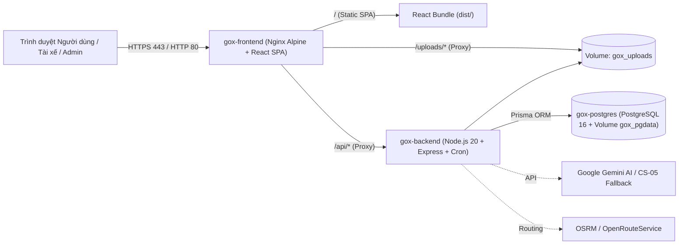

# HƯỚNG DẪN ĐÓNG GÓI DOCKER & TRIỂN KHAI PRODUCTION LÊN VPS UBUNTU

Tài liệu này hướng dẫn từng bước triển khai trọn gói nền tảng **GoX – Kết nối hành trình, Tối ưu chuyến đi** bằng Docker Compose, Nginx Reverse Proxy, chứng chỉ HTTPS miễn phí (Let's Encrypt Certbot) và cơ chế sao lưu dữ liệu PostgreSQL tự động hàng ngày.

---

## 1. KIẾN TRÚC TRIỂN KHAI CONTAINER



---

## 2. YÊU CẦU HỆ THỐNG (VPS)

- **Hệ điều hành**: Ubuntu 22.04 LTS hoặc 24.04 LTS.
- **Cấu hình tối thiểu**: 1 vCPU, 2 GB RAM, 20 GB SSD.
- **Cổng mạng (Firewall UFW)**: Mở cổng `22` (SSH), `80` (HTTP), `443` (HTTPS).
- **Tên miền (Domain)**: Đã trỏ bản ghi DNS loại `A` về địa chỉ IP của VPS (ví dụ: `gox.yourdomain.vn`).

---

## 3. CÀI ĐẶT DOCKER & DOCKER COMPOSE TRÊN VPS

Kết nối SSH vào VPS và chạy các lệnh sau:

```bash
# Cập nhật gói hệ thống
sudo apt update && sudo apt upgrade -y

# Cài đặt Docker Engine & Docker Compose Plugin chính thức
curl -fsSL https://get.docker.com | sudo sh
sudo usermod -aG docker $USER

# Kiểm tra phiên bản sau khi đăng nhập lại SSH
docker --version
docker compose version
```

---

## 4. TẢI MÃ NGUỒN & CẤU HÌNH BIẾN MÔI TRƯỜNG

```bash
# Tạo thư mục dự án
sudo mkdir -p /opt/gox && sudo chown $USER:$USER /opt/gox
cd /opt/gox

# Clone mã nguồn từ GitHub
git clone https://github.com/duykhoi2212/support_trip.git .

# Tạo file biến môi trường production từ mẫu
cp .env.docker.example .env
nano .env
```

Các thông số bắt buộc phải thay đổi trong `.env`:
- `POSTGRES_PASSWORD`: Đặt mật khẩu mạnh (khớp với `DATABASE_URL`).
- `JWT_SECRET`: Chuỗi ngẫu nhiên tối thiểu 32–64 ký tự (có thể sinh bằng `openssl rand -hex 32`).
- `GEMINI_API_KEY`: Nhập khóa Google Gemini AI (nếu để trống, hệ thống tự động vận hành mượt mà với CS-05 Regex Fallback).
- `SMTP_USER` & `SMTP_PASS`: Thông tin Gmail App Password cho tính năng Quên mật khẩu.
- `FRONTEND_URL`: Tên miền thực tế, ví dụ `https://gox.yourdomain.vn`.

> [!TIP]
> Nếu bạn muốn sử dụng cơ sở dữ liệu **Neon Cloud PostgreSQL** thay vì container `postgres` nội bộ, chỉ cần gán trực tiếp chuỗi kết nối Neon vào biến `DATABASE_URL` trong `.env`.

---

## 5. KHỞI CHẠY HỆ THỐNG BẰNG DOCKER COMPOSE

```bash
cd /opt/gox

# Build images multi-stage và khởi chạy ngầm toàn bộ services
docker compose up -d --build

# Kiểm tra trạng thái container (tất cả phải là Up / healthy)
docker compose ps

# Xem log khởi động Backend & Scheduler
docker compose logs -f backend
```

### Khởi tạo dữ liệu mẫu ban đầu (Seed Admin & Tài khoản demo)
Lần chạy đầu tiên, `backend/Dockerfile` đã tự động thực thi `npx prisma migrate deploy`. Để tạo sẵn tài khoản Quản trị viên và dữ liệu mẫu:

```bash
docker compose exec backend npx tsx prisma/seed.ts
```

Kiểm tra nhanh Health Check:
```bash
curl http://localhost/api/health
```
Kết quả trả về `{"success":true,"data":{"status":"UP",...}}` là hệ thống đã sẵn sàng hoạt động!

- Cổng người dùng & tài xế: `http://<IP_VPS>/`
- Cổng quản trị viên riêng biệt: `http://<IP_VPS>/admin/login`

---

## 6. CẤU HÌNH HTTPS / SSL MIỄN PHÍ VỚI NGINX HOST + CERTBOT

Để kích hoạt ổ khóa xanh `HTTPS` tự động gia hạn:

1. Đổi cổng container frontend trong `.env` sang `APP_PORT=8080` và chạy lại `docker compose up -d`.
2. Cài đặt Nginx & Certbot trên máy chủ VPS:
   ```bash
   sudo apt install -y nginx certbot python3-certbot-nginx
   ```
3. Tạo file cấu hình site `/etc/nginx/sites-available/gox`:
   ```nginx
   server {
       listen 80;
       server_name gox.yourdomain.vn;
       client_max_body_size 15M;

       location / {
           proxy_pass http://127.0.0.1:8080;
           proxy_http_version 1.1;
           proxy_set_header Host $host;
           proxy_set_header X-Real-IP $remote_addr;
           proxy_set_header X-Forwarded-For $proxy_add_x_forwarded_for;
           proxy_set_header X-Forwarded-Proto $scheme;
       }
   }
   ```
4. Kích hoạt cấu hình & cấp chứng chỉ SSL tự động:
   ```bash
   sudo ln -s /etc/nginx/sites-available/gox /etc/nginx/sites-enabled/
   sudo nginx -t && sudo systemctl reload nginx
   sudo certbot --nginx -d gox.yourdomain.vn
   ```

---

## 7. CÀI ĐẶT SAO LƯU CSDL TỰ ĐỘNG HÀNG NGÀY (BACKUP CRON)

Dự án đã cung cấp sẵn script sao lưu nén `.sql.gz` và tự động dọn dẹp các bản cũ hơn 7 ngày tại `scripts/backup-db.sh`.

```bash
# Cấp quyền thực thi cho script
chmod +x /opt/gox/scripts/backup-db.sh

# Chạy thử 1 lần để kiểm tra
/opt/gox/scripts/backup-db.sh

# Mở crontab để lập lịch chạy tự động lúc 02:00 sáng mỗi ngày
crontab -e
```

Thêm dòng sau vào cuối crontab:
```cron
0 2 * * * /opt/gox/scripts/backup-db.sh >> /var/log/gox-backup.log 2>&1
```

### Khôi phục dữ liệu từ bản sao lưu (khi cần)
```bash
gunzip -c /opt/gox/backups/gox_db_YYYYMMDD_HHMMSS.sql.gz | docker exec -i gox-postgres psql -U postgres -d gox_db
```

---

## 8. CẬP NHẬT PHIÊN BẢN MỚI & KHẮC PHỤC SỰ CỐ

```bash
# Kéo mã nguồn mới và rebuild không mất dữ liệu (volumes được giữ nguyên)
cd /opt/gox
git pull origin main
docker compose up -d --build

# Xem log khi cần kiểm tra lỗi
docker compose logs --tail=100 backend
docker compose logs --tail=100 frontend
```
