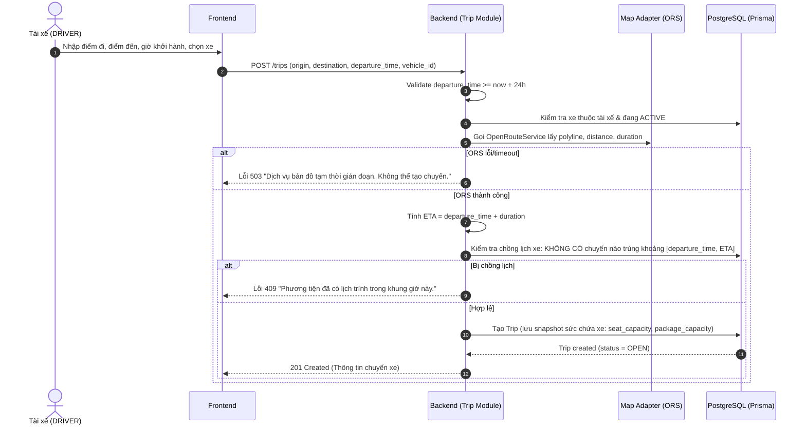
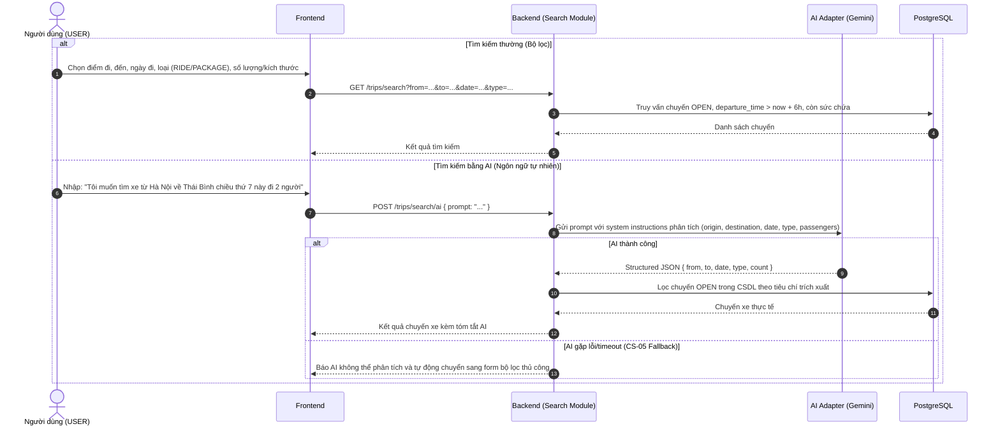
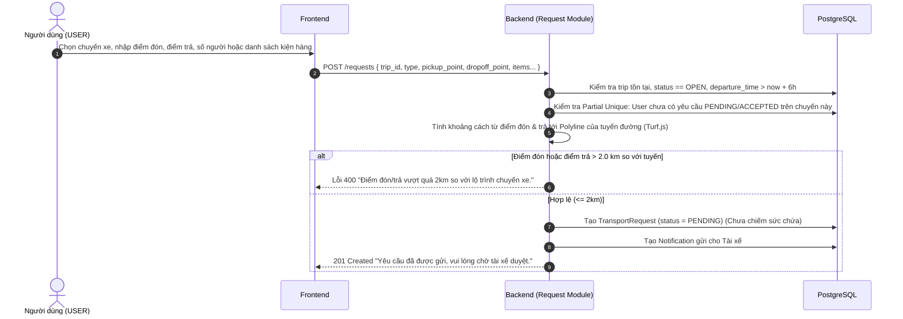
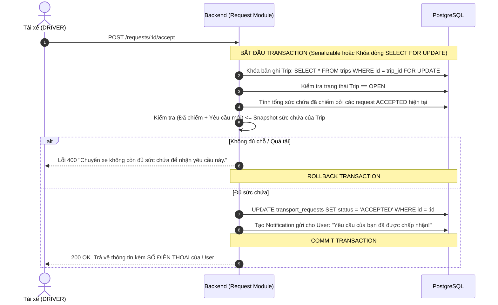
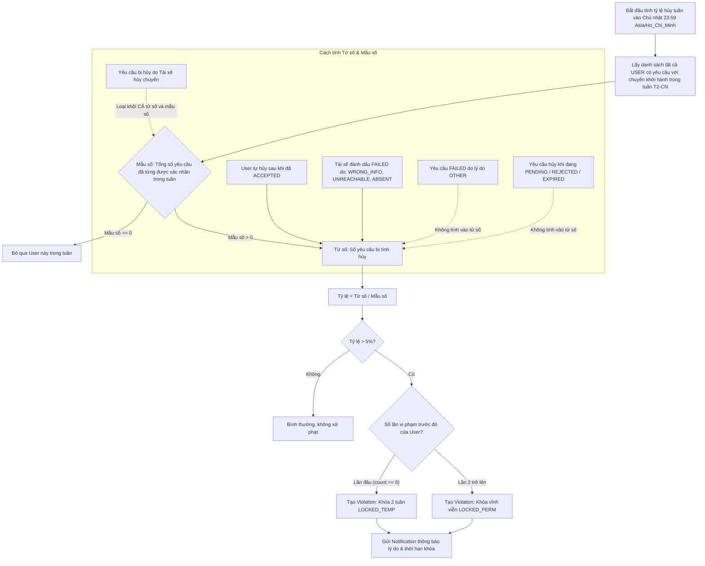

# KẾ HOẠCH DỰ ÁN VÀ QUY TRÌNH NGHIỆP VỤ (ROADMAP & BUSINESS FLOWS)

Dự án: **Nền tảng kết nối đi nhờ và gửi đồ theo chuyến xe tích hợp AI hỗ trợ điều phối**  
Thời lượng cam kết: **7 Ngày**  
Mục tiêu: Đồ án tốt nghiệp hoàn chỉnh, kiến trúc chuẩn mực, logic xử lý chặt chẽ không có kẽ hở dữ liệu.

---

## 1. CÁC QUY TRÌNH NGHIỆP VỤ CỐT LÕI (BUSINESS FLOWS)

### 1.1. Luồng 1: Tạo Chuyến Xe (DRIVER)

### 1.2. Luồng 2: Tìm Kiếm Chuyến Xe (USER) - Thường & AI

### 1.3. Luồng 3: Tạo Yêu Cầu & Kiểm Tra Bán Kính 2km (USER)

### 1.4. Luồng 4: Duyệt Yêu Cầu & Giữ Chỗ Nguyên Tử (DRIVER)

### 1.5. Luồng 5: Hủy Yêu Cầu, Tính Tỷ Lệ Hủy & Xử Phạt Vi Phạm (CS-02, CS-03)

---

## 2. KẾ HOẠCH THỰC HIỆN 7 NGÀY (7-DAY ROADMAP)

| Ngày | Giai đoạn & Nội dung công việc | Mã chức năng liên quan | Deliverables / Kết quả kiểm tra |
| :--- | :--- | :--- | :--- |
| **Ngày 1** | **Khởi tạo kiến trúc Monorepo & CSDL chuẩn** - Thiết lập thư mục `backend/` và `frontend/` - Cài đặt dependencies, cấu hình TypeScript, ESLint, Zod - Viết `schema.prisma` chính xác 100% từ file DBML - Chạy Prisma migration, Seed dữ liệu mẫu đầy đủ roles - Unit tests cho các hàm helper cốt lõi (khoảng cách 2km Turf.js, tính tỷ lệ hủy) | Khung nền tảng | - Monorepo chạy được lệnh dev cả 2 bên - PostgreSQL có đủ 9 bảng, migration sạch sẽ - Seed 1 admin, 2 tài xế, 3 xe, 3 user |
| **Ngày 2** | **Xác thực, Phân quyền & Quản lý Hồ sơ** - Module `auth-account` (JWT, bcrypt, cookie/bearer) - Middleware phân quyền `requireRole` (USER, DRIVER, ADMIN) - APIs: Đăng ký, Đăng nhập, Xem/Sửa hồ sơ, Đổi mật khẩu, Upload avatar qua multer - Giao diện Login, Register, Profile | CM-01 CM-02 CM-03 | - Đăng ký role cố định, không đổi SĐT - Đăng nhập nhận JWT hợp lệ - Quản lý thông tin & avatar lưu tại `uploads/` |
| **Ngày 3** | **Quản lý Phương tiện & Điều phối Chuyến xe** - Module `vehicle` (Thêm xe kèm ảnh, bật/tắt, chặn trùng biển số) - Module `map-adapter` (Kết nối OpenRouteService lấy polyline & ETA) - Module `trip` (Tạo chuyến >= 24h, kiểm tra chồng lịch không đệm, snapshot sức chứa, xem danh sách, hủy chuyến) - UI Tài xế: Quản lý xe, Bản đồ tạo chuyến & xem lộ trình Leaflet | DR-04 DR-01 DR-05 | - Tạo xe thành công với ảnh upload - ORS vẽ tuyến đường chính xác trên bản đồ - Chặn tạo chuyến nếu xe trùng lịch |
| **Ngày 4** | **Yêu cầu Vận chuyển, Duyệt Chỗ & Quản lý Chuyến** - Module `transport-request` (Tạo yêu cầu RIDE / PACKAGE, kiểm tra 2km polyline) - Duyệt yêu cầu nguyên tử: `SELECT ... FOR UPDATE` kiểm tra snapshot sức chứa - Điều hành tiến trình: Picked Up, Dropped Off, Delivered, Failed (kèm lý do) - Module `notification` (Polling, đánh dấu đã đọc, chuông thông báo) - UI Người dùng gửi yêu cầu, UI Tài xế duyệt & điều hành chuyến | US-01 US-03 DR-02 DR-03 | - Kiểm tra 2km chuẩn xác - Khóa nguyên tử chống vượt sức chứa - Hiển thị SĐT 2 bên ngay sau khi ACCEPTED |
| **Ngày 5** | **Các Tác vụ Hệ thống Định kỳ (Cron Jobs)** - Module `scheduler` (Node-cron):   + **CS-01**: Mỗi phút quét đóng chuyến trước 6h & chuyển yêu cầu PENDING thành EXPIRED   + **CS-02**: Chốt tỷ lệ hủy tuần (T2-CN, giờ VN), xử phạt khóa tài khoản   + **CS-03**: Mở khóa tự động cho LOCKED_TEMP sau 14 ngày   + Cơ chế chạy bù (catch-up) khi server reboot | CS-01 CS-02 CS-03 CS-04 | - Test mô phỏng mốc -6h hoạt động chính xác - Test mô phỏng chốt tỷ lệ hủy > 5% khóa tài khoản |
| **Ngày 6** | **Tìm kiếm Thông minh với Gemini AI & Sự cố & Admin** - Module `ai-adapter`: Prompt Gemini trích xuất ý định tiếng Việt ra structured query - Cơ chế CS-05: Fallback tự động sang tìm kiếm thường khi AI lỗi - Module `incident` (Báo cáo sự cố, chuyển trạng thái 4 bước có thông báo) - Module `admin` (Mở khóa tài khoản có lý do + audit log, thống kê chuyến theo ngày) - UI Admin Dashboard, UI Tìm kiếm AI | US-02 CS-05 CM-04 AD-01 AD-02 AD-03 | - Tìm kiếm AI hiểu tiếng Việt tự nhiên - Admin xem thống kê, mở khóa tài khoản ghi log đầy đủ |
| **Ngày 7** | **Đóng gói Docker, Tối ưu Giao diện, Test & Hướng dẫn VPS** - Tích hợp bản thiết kế giao diện từ Google Stitch (nếu có) - Dockerfile tối ưu multi-stage build cho Frontend & Backend - File `docker-compose.yml` (PostgreSQL, Backend, Nginx reverse proxy, Volume uploads) - Viết tài liệu hướng dẫn triển khai VPS chi tiết (SSL Certbot, script backup CSDL) - Rà soát toàn bộ lỗi và hoàn thiện đồ án | Đóng gói & Triển khai | - Chạy thử nghiệm thành công 100% trên môi trường Docker - Sẵn sàng bảo vệ đồ án tốt nghiệp |

---

## 3. CÁC ĐỀ XUẤT KỸ THUẬT QUAN TRỌNG ĐỂ HỆ THỐNG TRƠN TRU

1. **Thuật toán tính khoảng cách 2km tới Polyline của tuyến đường**:
   - ORS trả về lộ trình dạng GeoJSON LineString hoặc Encoded Polyline.
   - Sử dụng thư viện `@turf/point-to-line-distance` (chuẩn tính toán trắc địa WGS84) để tính khoảng cách vuông góc ngắn nhất từ tọa độ điểm đón/trả đến Polyline.
   - Đảm bảo độ chính xác tuyệt đối, nhanh chóng và không phụ thuộc API bên ngoài khi tính khoảng cách.

2. **Chống Overbooking & Tranh chấp dữ liệu (Race Condition)**:
   - Dùng Transaction mức cao nhất hoặc raw SQL query trong Prisma:
     `SELECT id, seat_capacity, package_capacity FROM trips WHERE id = $1 FOR UPDATE;`
   - Tính tổng các request đã `ACCEPTED` + request đang được duyệt, so sánh trực tiếp với snapshot của Trip. Nếu vượt quá, lập tức Rollback và trả mã `INSUFFICIENT_CAPACITY`.

3. **Tính toán Tỷ lệ hủy theo đúng tuần Giờ Việt Nam (`Asia/Ho_Chi_Minh`)**:
   - Sử dụng thư viện `date-fns-tz` hoặc `dayjs` để xác định chính xác ranh giới đầu tuần (Thứ Hai 00:00:00) và cuối tuần (Chủ Nhật 23:59:59) theo giờ Việt Nam, bất kể VPS đặt ở timezone nào.

4. **Cơ chế Catch-up (Chạy bù) của Cron Job**:
   - Khi Backend khởi động lại, hàm `bootstrapScheduler()` sẽ ngay lập tức chạy quét các chuyến có `departure_time <= now + 6h` mà vẫn còn `OPEN` để chuyển về `CLOSED`, và huỷ các request `PENDING` thành `EXPIRED` để tránh tình trạng hệ thống bị tắt qua mốc -6h mà dữ liệu không được cập nhật.
